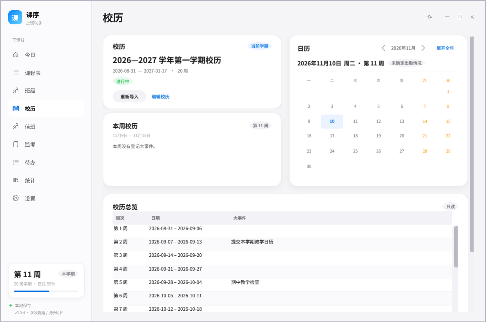
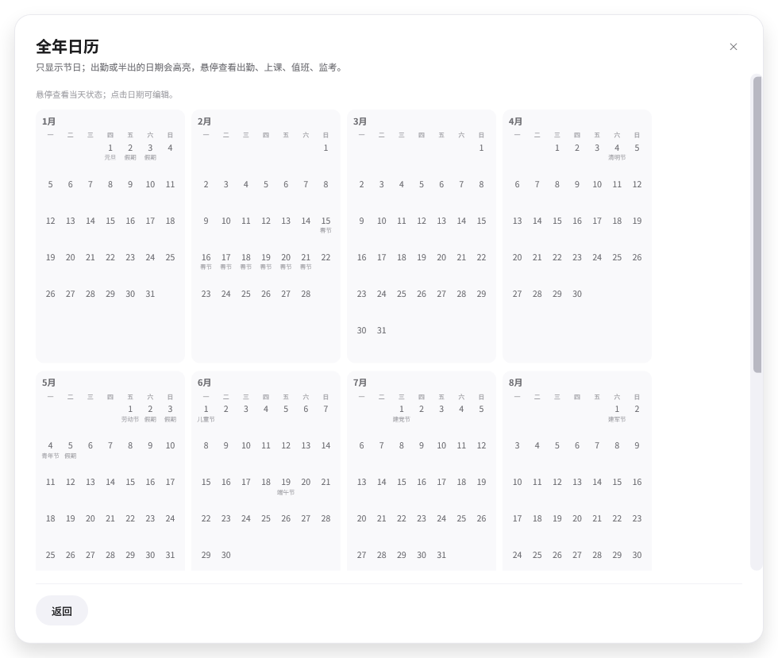
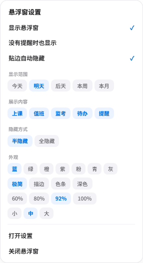
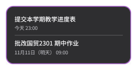
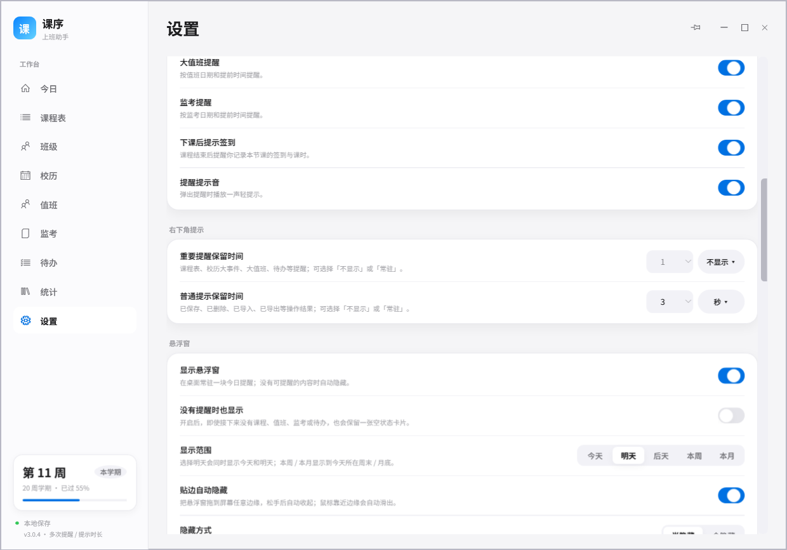
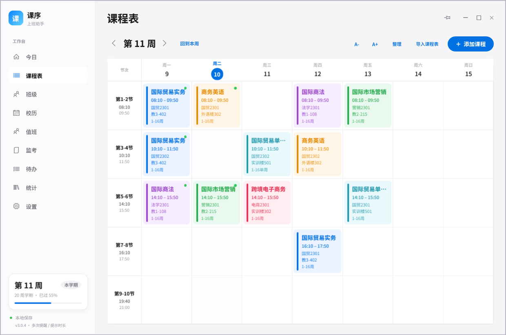
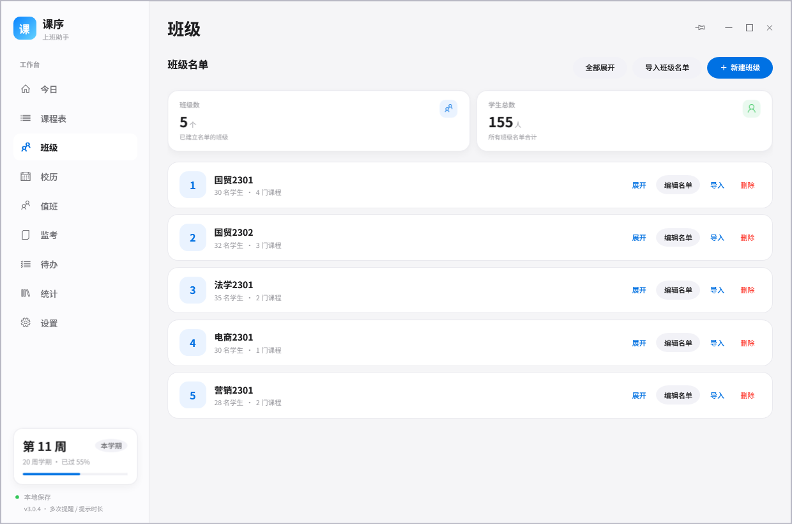
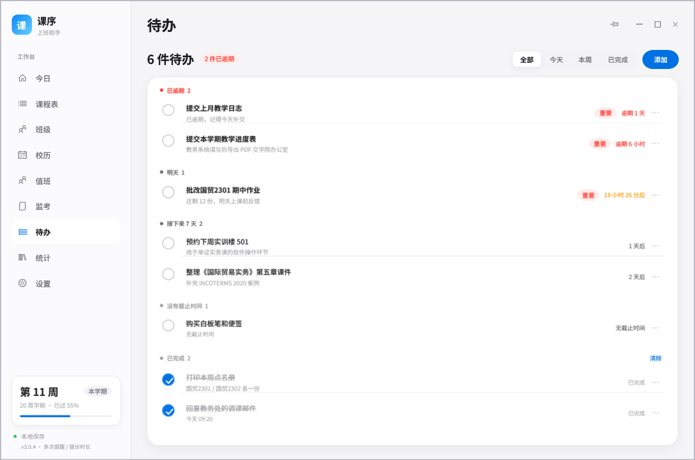
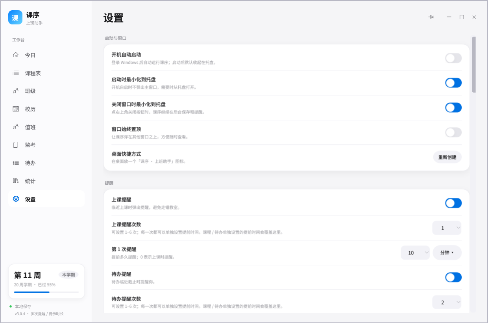

# 课序 · 上班助手

一款给老师、培训师和每天要站讲台的人用的**本地桌面工作台**。课程表、上课提醒、下课签到、校历导入、大值班、待办倒计时和课时统计，都在一个安静的窗口里。


## 下载与更新

- 下载页：https://feihesl.github.io/kexu-releases/
- 最新安装包：[Releases](https://github.com/feihesl/kexu-releases/releases)

## 3.1.0 在线发布与自动更新

- **公开下载页**：https://feihesl.github.io/kexu-releases/
- **公开 Release**：https://github.com/feihesl/kexu-releases/releases
- 安装包内含 `安装.cmd`，解压后运行即可安装到当前用户目录并创建快捷方式。
- 应用启动后会检查公开版本的 `update.json`；发现新版本时提示下载，校验 SHA-256 后自动替换并重启。
- 源代码仍保存在私人仓库；公开仓库只放安装包、版本清单和下载页。
- **移动版规划**：当前桌面端为 WPF，手机端不能直接复用界面。后续移动版需要单独的跨平台客户端（Flutter / .NET MAUI 等）和云同步服务；现有本地 JSON 数据结构会作为同步模型的基础。

## 3.0.4 出勤、日历与悬浮窗保持区

- **悬浮窗保持区**：鼠标在悬浮窗与屏幕边缘之间的空隙、悬浮窗周围约 32px 内都算“正在使用”，不会收回；鼠标离开这片区域后 150ms 才收回。弹出 / 收回动画调整为 220ms，比 3.0.3 更稳。
- **悬浮窗显示范围**：隐藏窄边附近 24px + 悬浮窗周围区域都会触发滑出；全隐藏仍然只靠屏幕边缘触发。
- **今日监考 / 值班只看重点**：只显示包含重点标注人名的监考和值班；没有重点记录时不显示卡片。
- **开机补发提醒**：提醒时间到点时如果电脑没开机，下次启动会立即补发当天错过的上课、下课、待办、值班、监考和校历提醒。
- **监考明细直接编辑**：单击单元格即可编辑，进入编辑后自动全选；多个重点关注人名显示在最右侧。
- **值班按校历周次**：大值班左侧周次按校历周次排列，不再按每月第几周；人名加大、黑色、居中，有备注显示「备」标记。
- **提示时间选项**：重要提醒和普通提示均可选「不显示 / 常驻 / 秒 / 分钟 / 小时」，数字从 1 开始。
- **首页无课问候**：今天没课时显示随机无课问候，下方卡片显示下一节课。
- **今日日期**：年月、日、星期、周次全部放大；日期卡内不再显示“今日”，重大节日 / 假日会显示在日期下方。
- **下一节课日期**：和悬浮窗一致，显示 `11月11日（明天）` 这样的日期提示。
- **今日待办**：默认只露出最上面 2 条待办，更多待办通过纵向滚动 / 拖动查看；点击待办圆圈只完成，点击文字区域才编辑。
- **出勤卡**：每日第一次打开显示 出勤 / 半出 / 休息 / 请假 四个选项，采用一行两个、两行排列，按钮和字更大；出勤 1 天、半出 0.5 天、休息和请假不计。选择后显示本月出勤天数，再点卡片可编辑年月日区间；未选择按休息计。
- **上课工作量**：本周 / 本月 / 累计都改为“上课工作量”；累计卡点击可编辑年月日区间，并按区间重新统计。
- **出勤与统计**：所有“平均出勤”改为“出勤”，统计上班出勤日期；统计页工作概览同步改为出勤天数、上课工作量。
- **日历卡片**：校历页的课程表导入卡改为日历卡，本周校历移动到校历卡下方，左右两列高度对齐；悬停 1 秒显示浅色提示，列出上课 / 值班 / 监考次数 / 出勤状态；点击日期可编辑出勤、监考次数。\n- **全年日历独立页面**：点击“展开全年”进入带返回的上层页面，可 A- / A+ 缩放；放大后按 节日、出勤、上课、值班、监考 的顺序显示更多信息，不再挤在校历页里。\n- **值班页**：页面标题和卡片里的“大值班”统一改为“值班”。
- **课程表导入**：入口移到课程表工具栏。
- **设置提醒**：设置 → 提醒保留大值班提醒、监考提醒开关。



\n

## 3.0.3 悬浮窗提速、样式与提醒范围

- **右键悬浮窗设置**：右键悬浮窗会展开插件式设置菜单，分组包含显示开关、显示范围、展示内容、隐藏方式、颜色、样式、透明度、大小，以及打开设置 / 关闭悬浮窗。
- **颜色与样式**：新增 7 种颜色（蓝 / 绿 / 橙 / 紫 / 粉 / 青 / 灰）和 4 种样式（极简 / 描边 / 左侧色条 / 深色），边框更明显；颜色和样式会同时应用于设置菜单的选中态。
- **悬浮窗响应更快**：鼠标检测 40ms，移入 / 移出动画 150ms；光标离开后 30ms 开始收回，不再停留。
- **拖动光标修正**：只有按下鼠标左键时才显示拖动光标；平时悬停在隐藏窄边上仍是普通箭头，不会误以为要拖动，也不会阻挡滑出。
- **左右贴边更稳**：贴边阈值放大，并同时参考鼠标位置；隐藏动画期间不会误清除防回弹状态，左右边缘不再偶发不隐藏。
- **半隐藏 / 全隐藏**：设置 → 悬浮窗或右键菜单可切换。半隐藏保留一条窄边；全隐藏会完全移到桌面外，只靠鼠标靠近屏幕边缘触发。
- **显示范围**：可选择今天 / 明天 / 后天 / 本周 / 本月；选择明天会同时显示今天和明天，选择本周 / 本月显示到周末 / 月底。
- **日期提示**：明天、后天、本周、本月的事件会在日期后加提示，例如 `11月12日（明天）`、`11月14日（本周五）`、`11月20日（本月）`。
- **今日日期更醒目**：「今日」卡片去掉“今日”字样，日期数字从 38 放大到 46，年月和星期同步放大。
- **课程表默认更大**：默认节次高度从 108 调到 118，A- / A+ 仍可继续调整。
- **提醒设置补全**：设置 → 提醒新增「大值班提醒」「监考提醒」开关。







## 3.0.2 界面精简与悬浮窗重做

- **悬浮窗极简**：只保留事件名称和时间，去掉“今日提醒”标题、课序 logo、分类标签、详情小字、底部“打开课序”和彩色色块；整体只保留黑灰文字，1 小时内有事件才用红色显示“特别提醒”和对应条目。
- **贴边修复**：修正默认位置（优先主屏右下角）、上 / 左 / 右边缘的屏幕判断，以及拖到边缘松手后被鼠标立刻重新弹出的问题；隐藏与出现都改为 260ms 缓动平移。
- **今日待办稳定**：勾选任务只在对号上变化，不改变任务标题、时间和行布局；全部完成后仍保留原任务行，不再出现“待办都完成了”的大空状态。右侧待办卡片与左侧课程卡片强制等高。
- **页面去小字**：去掉课程表、班级、校历、大值班、监考、待办、统计、设置等页面标题下的浅色说明小字，以及各卡片标题下的重复说明。
- **卡片更整齐**：今日、统计、校历的左右卡片改为等宽，设置页铺满对齐，左右留白对称。


## 3.0.1 修复

- **悬浮窗不再“看不到”**：即使今天的课已经上完，也会显示 72 小时内的下一节课；周末或没有近期课程时，可以在 设置 → 悬浮窗 打开「没有提醒时也显示」，保留一张空状态卡片。
- **空状态卡片**：开启后显示「今天没有需要提醒的内容」，下一节课、值班、监考或待办出现时会自动替换。

## 3.0.0 新增桌面悬浮窗

- **今日提醒悬浮窗**：显示正在进行 / 下一节课、今日大值班、今日监考、今天到期或逾期的待办，以及自定义提醒；某一类没有内容就不显示，全部没有时悬浮窗自动隐藏。首次升级默认开启，可在设置里关闭。
- **四边贴边隐藏**：把悬浮窗拖到屏幕任意边缘松手，会自动收到该边缘后，只留一条窄边；鼠标靠近窄边 **不用点击** 就会滑出——左右边缘横向移出，上下边缘向上 / 向下移出。
- **360 风格弹出动画**：悬浮窗出现时带轻微缩放和淡入，贴边收放使用缓动横移，不会突兀跳变。
- **外观与内容可调**：设置 → 悬浮窗 可以分别开关上课 / 大值班 / 监考 / 待办 / 自定义提醒，调整透明度（30%–100%）、尺寸（小 / 中 / 大）和是否贴边自动隐藏；尺寸越大，显示的信息条数和细节越多。
- **托盘快捷开关**：托盘菜单里有「显示悬浮窗」，关闭悬浮窗后也可以在设置里重新打开。
- **本次整体检修**：设置页版本号改为读取程序版本；托盘 / 开机静默启动统一走完整初始化；关闭、退出时正确释放悬浮窗和托盘资源；修复悬浮窗首次出现位置和多屏 / 分辨率变化后的贴边位置。


## 2.9.2 修复

- **下一节课卡片去重**：今日页的下一节课卡片只在标题显示一次「下一节课」，星期和日期合并成一个标签，时间只在课程行显示；去掉了底部重复的「下一节课 · … 08:10」。
- **今日日期合并**：年、月、日、星期和周次统一放进「今日」卡片的同一个日期块，标题栏不再单独重复周次。
- **今日待办就地勾选**：勾选待办后，当前条目保留在原位并显示对号和删除线，卡片高度不变；再次点击可以取消，未完成 / 已完成数量同步更新。
- **监考明细提示**：只保留「双击某行可编辑」，并紧挨「监考信息明细」右侧显示，去掉了后面的字段说明。

## 2.9.1 修复

- **班级名单默认折叠**：班级页每张卡片的名单默认收起；右上角「全部展开 / 全部收起」可一键切换，也可以单独展开某个班级。
- **今日页更清爽**：无课或当天课程结束时，去掉与大字重复的小字问候；如果还有下一节课，则保留下一节课信息。今日日期只保留总览卡片里的醒目日期，去掉页面中重复的日期。
- **提示保留时间修复**：右下角提示的「重要提醒 / 普通提示保留时间」可以正常在 **秒 / 分钟 / 小时 / 不显示 / 常驻** 之间切换，不会选完又跳回秒。

## 这次新增的能力

- **数字选择器统一**：所有时间 / 数字输入都改成居中数字框，点击后自动全选数字，可直接输入覆盖；正下方平滑展开可选数字，点别处、选完或展开另一个框时自动收起，同一时间只保留一个展开框。
- **精准提醒时长**：课程、待办、大值班、自定义提醒和全局设置里的提前量 / 间隔都改成「数字 + 单位」：点单位按钮在正下方展开 **天 / 小时 / 分钟**，风格与整体一致。
- **待办截止时间选择**：新建 / 编辑待办不再手填时间，改为年、月、日、时、分五个选择框；「设置截止时间」只有点圆圈才会选中或取消，点文字不生效；下方提供「一天后、两天后、三天后、五天后、一周后、一月后」快捷项，点击后日期直接跳转。
- **签到名单芯片化**：请假 / 缺勤名单去掉可打字框；在上方点名区点「假 / 缺」后，对应学生姓名会以和点名框一致的样式加入下方请假 / 缺勤名单，点名单里的姓名可移回「到」。
- **今日页更简洁**：去掉「今日课程」卡片里重复的「下一节」横条，只保留顶部大卡片的下一节信息。
- **大值班时间更紧凑**：日期改成和待办一致的年 / 月 / 日选择；开始、结束时间紧挨「至」字排列，提前提醒、间隔等数字居中；所有同类数字框统一高度。
- **工作量统计**：按「1 节课（45 分钟）= 1 课时」计算，一次两节课 = 2 课时；首页和统计页新增本周 / 本月 / 累计工作量，最近课堂也显示课时。
- **待办添加更直接**：待办页去掉整行的快速输入框和加号，只保留「添加」按钮，点击直接弹出完整设置弹窗。
- **学生名单标签**：班级、课程、点名名单统一用居中姓名标签；点击姓名可标记 / 取消重点关注，页面不会跳回顶部。
- **班级序号**：班级卡片左侧方块显示当前序号，不再显示班级名首字。
- **右键菜单**：所有右键菜单统一为圆角、浅色、轻阴影样式；菜单打开时点击其他位置只关闭菜单，不会误触下层按钮或课程格。
- **值班 / 监考清空与点格编辑**：两个页面都支持一键清空；点击方格中的姓名可编辑对应记录。
- **多人名显示**：方格内多个人名之间空两个空格，文字居中。
- **收工下一节课**：首页收工问候的小字会显示下一节课名称、日期时间和倒计时，不再重复大字问候。
- **所有导入都支持图片**：课程表、校历、班级名单、大值班、监考都可以选 PNG / JPG / BMP；图片没有表格线时会退化为整页 OCR，再按位置还原行列。
- **图片识别说明**：图片 OCR 受清晰度、字体和拍照角度影响，无法保证 100% 自动准确；导入预览中的每个字段都可以改。若来源是 Excel / Word，直接导入原文件可避免 OCR 错字。
- **监考字段**：监考信息按「学院 → 课程代码 → 课程名称 → 考试时间 → 考场 → 人数 → 主监考 → 副监考 → 任课教师 → 班级组成」展示和导入；监考页底部有完整明细表。
- **课程名单选择**：编辑课程时可以直接选「选择已有班级」，把班级名单带入课程；名单用顿号分隔、单行横向滚动，不再一人一行。
- **今日收工问候**：当天课程全部结束后，首页会显示「今天收工」和 12 句随机问候；如果是本周最后一节课，则显示「本周收工」和另外 12 句周末问候。
- **下课提醒**：按课表到达下课时间就提醒签到，不要求先点过「开始上课」；每 6 秒检查一次。
- **校历只读总览**：校历页新增只读表格，逐周查看日期和大事件；自定义提醒已从校历移除（与待办重复）。
- **大值班 / 监考页**：左侧新增「值班」「监考」。导入图片、PDF、Word、Excel 后生成按月份 / 周次 / 星期排列的方格；可以在设置里记住多个人名，重点标注本人值班、监考以及所教课程考试，并设置提醒次数和每次提前时间。
- **今日监考 / 值班**：当天有监考或值班时，「今日」页会显示卡片；重点安排会标出。
- **工作统计**：统计页新增「工作概览」，按本周和累计显示上课、监考、大值班、工作量和出勤。
- **首页校历大事件**：如果本周校历里登记了大事件，「今日」页会在课程卡片下方显示一张「本周校历大事件」卡片，列出本周全部事项，点击可进入校历页。没有大事件时不占位置。
- **多次提醒**：上课和待办都可以在设置中选择提醒次数（1–6 次），每一次单独设置提前时间；0 表示上课 / 截止时提醒。课程和待办里单独设置的提前时间优先。
- **统计项删除**：统计页的「课程分布」每一行右侧都有删除图标，可以只清除该课程的授课记录、课时和出勤统计；课程表和提醒不会受影响。
- **右下角提示分级**：上课、下课点名、大值班、待办这类重要提醒默认一直停留，直到点击或点 ×；已添加、已删除等操作结果默认 3 秒后自动消失，点击也会立即关闭。**设置 → 右下角提示** 可以分别设置「重要提醒」和「普通提示」的保留时间，支持 **秒 / 分钟 / 小时**，设为 0 表示一直保留。
- **窗口动画更顺滑**：最大化 / 还原改为 190ms 的缓动动画，不再瞬间跳变。
- **按节次排课**：课程表改成 5 个节次格，第一、二节 08:10–09:50，第三、四节 10:10–11:50，第五、六节 14:10–15:50，第七、八节 16:10–17:50，第九、十节 19:40–21:00。每格 100 分钟，格子之间有横线，课程不再串行或错位；字号也放大了。
- **多段周次**：编辑课程时可以添加多段周次，例如 1–8 周加 10–16 周，每段还能单独设单周 / 双周；课程表、导出和提醒都会按所有周次判断。
- **调课 / 补课**：编辑课程时可以填「指定日期」，这门课只在当天出现一次，不再按星期或周次重复，适合临时调课、补课和单次讲座。
- **当天才能开始上课**：课程当天才有「开始上课」；不是当天显示灰色「暂未开始」，不能点击。点击后「今日」会显示「上课中」，并出现「下课签到」。
- **班级名单**：左侧新增 **班级** 页，可以从 Excel / Word / CSV / TXT / PDF 导入班级名单，也可以手动新建、改名、追加名单、删除班级。
- **学生名单导入**：编辑课程时可以直接导入 Excel 等名单文件，填入课程学生名单。
- **签到更完整**：课堂签到增加「缺勤人数」；请假名单和缺勤名单以点名芯片显示，在上方点「假 / 缺」即可加入，点名单里的名字可移回「到」。
- **课程按校历周次显示**：课程表严格按校历里的「第几周」显示，第 18 周的课不会提前出现在第 1 周；单周、双周、`2-4,8-17` 这类非连续周次也只出现在对应周。
- **导入周次不再丢失**：导入预览里的 `18`、`7-10`、`1-3,6-17` 等周次会原样保存到课程，不再被回退成整学期。
- **蓝色背景统一白字**：主按钮（如「开始上课」「加入课程表」）等蓝底控件使用纯白文字。
- **导入校历**：支持图片、PDF、Word(.docx)、Excel(.xlsx)、CSV/TXT。自动识别周次、周一日期和「主要工作事项」，识别结果可以先在表格里改，再应用。
- **导入课程表**：同样支持图片/PDF/Word/Excel 等。自动拆出星期、节次、课程、班级、地点和周次范围，可逐行修改后批量加入课表。
- **按日期课程表**：把校历、课程、大值班、自定义提醒合并，按日期导出 **Excel(.xlsx)** 或 **CSV**，方便打印或发给别人。
- **大值班提醒**：按日期、开始/结束时间、提前分钟、提醒次数和间隔提醒。
- **自定义提醒**：任意日期、时间、提前量、提醒次数和间隔。
- **每周校历大事件**：在每一周的第一个日期，弹出「本周校历」综合提醒，列出该周所有大事件。
- **校历过期提醒**：校历结束日期之后，每天提醒一次「请导入新学期校历」。
- **更大的提醒弹窗**：提醒卡片的标题、正文和操作按钮都放大了。
- **蓝色按钮统一白字**：主按钮使用纯白半粗体。

## 导入校历 / 课程表的流程

1. 打开左侧 **校历** 页。
2. 点 **导入校历文件**，选择校历图片、PDF、Word、Excel 或 CSV/TXT。
3. 等识别完成后，检查 **周次 / 周一日期 / 大事件** 三列，直接双击修改。
4. 点 **应用校历**。系统会自动把「第一教学周周一」写入学期设置。
5. 点 **导入课程表文件**，选择教务系统导出的课表图片/PDF/Word/Excel。
6. 检查 **星期 / 节次 / 课程 / 班级 / 地点 / 周次**，可修改、添加、删除行，然后点 **加入课程表**。
   - 重新导入时保持 **「替换当前课程表」** 勾选，旧课程会被本次结果替换，避免重复和遮挡。
   - 如果这次只想追加课程，取消勾选即可。
7. 如果学校节次时间和默认不同，到 **设置 → 校历与大值班 → 课程节次时间** 调整。
8. 点 **导出 Excel** 得到按日期排列的课程表。

> 图片和扫描版 PDF 使用 Windows 自带的 OCR，识别结果受清晰度影响，所以设计成「先预览、可修改、再应用」。`.xlsx` / `.docx` / 文本版 PDF 是精确解析，不需要 OCR。

### 支持的文件格式

| 格式 | 支持情况 |
| --- | --- |
| `.xlsx` | 原生解析，不依赖 Office |
| `.docx` | 原生解析，不依赖 Office |
| `.pdf`（文字版） | 原生提取文字 |
| `.pdf`（扫描版） | 页面渲染 + Windows OCR |
| `.png` / `.jpg` / `.jpeg` / `.bmp` / `.tif` | 表格线检测 + 分块 OCR |
| `.csv` / `.tsv` / `.txt` | 文本表格解析 |
| `.doc` / `.xls` | 旧版二进制格式，请先用 WPS/Office 另存为 `.docx` / `.xlsx` |

## 已有功能

- **今日总览**：下一节课/正在上课、倒计时、今日课程、待办倒计时、本周校历、今日值班、课时统计。
- **课程表**：按 5 个节次格排列（每格 100 分钟），课程自动落在对应节次；支持多段周次、单双周、课程颜色、课前提醒、点击编辑；每个课程块显示时间、班级、地点和周次范围，字号加大；同一时间有 2 门课并排堆叠，3 门以上合并成「N 门课程」卡片，点击选择；右上角 **A- / A+** 或 **Ctrl + 滚轮** 可调整节次格高度；**整理** 可清理完全重复的课程。
- **按校历周次排列**：校历导入后，课程会按校历中的「第几周」和实际周一日期排列；单周/双周、非连续周次（如 2-4、8-17 周）只在对应周出现。更新校历或课程表后会自动重排。
- **班级名单**：班级页可新建、改名、删除班级，支持从 Excel / Word / CSV / TXT / PDF 导入名单，改班级名时关联课程和历史记录会一起更新。
- **上课 / 签到**：课程当天才能开始上课，开始后「今日」显示「上课中」，下课后提示签到；名单逐个「到 / 假 / 缺」，请假和缺勤名单自动同步姓名芯片，也支持只记人数或只记课时。
- **待办**：截止时间、优先级、倒计时、逾期标红、今天/本周/已完成筛选。
- **统计**：累计授课、总课时、出勤天数、待办完成率、近 7 天授课、课程分布、最近课堂；上课工作量按课时统计（45 分钟 = 1 课时）。
- **提醒**：课程、待办、大值班、自定义提醒都支持提前 / 间隔的 天 / 小时 / 分钟 选择；重要提醒停留到手动关闭，普通操作提示 3 秒后自动消失。
- **桌面常驻**：托盘菜单、窗口置顶、单实例、关闭到托盘。
- **自动保存**：每次修改自动落盘；窗口关闭、注销/关机前再写一次，并保留 `data.bak.json`。
- **开机自启**：设置里可开关；启动后默认在托盘待命。

## 数据放在哪里

默认位置：

```
%APPDATA%\KeXu\data.json
```

- `data.json`：课程、待办、签到、校历、大值班、自定义提醒和设置。
- `data.bak.json`：上一次自动备份。
- 设置页可打开数据文件夹、立即备份、导出/导入 JSON。
- 不上传云端，不需要账号，也没有广告。

## 在其他电脑上使用

把 `课序-win64.zip` 解压到任意文件夹，双击 `课序.exe` 即可：

- 不需要安装 DeepSeek Harness、Node.js、Electron 或 Office。
- 需要 Windows 10 / 11，且系统带 .NET Framework 4.8（Windows 10 1903+ 和 Windows 11 默认自带）。
- 图片/扫描 PDF 识别需要 Windows 中文 OCR 语言包（中文版 Windows 通常已带）。
- 程序没有购买代码签名，第一次运行如果出现「Windows 已保护你的电脑」，点「更多信息」→「仍要运行」即可。
- 第一次打开会自动创建桌面快捷方式；需要开机自启时到「设置」里打开即可。

## 截图

| 课程表 | 校历 |
| --- | --- |
|  |  |

| 班级名单 | 课堂签到 |
| --- | --- |
|  |  |

| 待办 | 统计 |
| --- | --- |
|  |  |

| 设置 | 导入校历 |
| --- | --- |
|  |  |

## 技术说明 / 二次开发

课序是一个 **.NET Framework 4.x + WPF** 的单文件桌面程序，不依赖 Electron、Node 或网络。源码在 `src/`：

| 文件 | 作用 |
| --- | --- |
| `Program.cs` | 入口、单实例、异常处理、导入/导出测试模式 |
| `Models.cs` | 课程、待办、课堂、校历、大值班、自定义提醒、设置 |
| `Logic.cs` | 教学周、课表展开、校历周、倒计时、统计 |
| `Store.cs` | JSON 持久化、备份、开机自启、快捷方式 |
| `theme.xaml` / `Theme.cs` / `UI.cs` | Apple 风格视觉系统、通用控件、DataGrid 样式 |
| `MainWindow.cs` | 窗口外壳、侧边栏、托盘、窗口消息 |
| `Page*.cs` | 今日、课程表、班级、校历、待办、统计、设置页面 |
| `Dialogs/*.cs` | 课程、班级名单、待办、签到、校历导入、课表导入、大值班、自定义提醒、节次时间 |
| `Import/*.cs` | XLSX/DOCX/CSV/TXT/PDF/OCR/图片表格解析、课程表与校历解析、名单导入、Excel 导出 |
| `Toast.cs` / `Notifications.cs` | 右下角提醒、上课/待办/校历/值班/自定义提醒 |

构建（Windows，已安装 .NET Framework 4.x）：

```bat
build.cmd
```

或：

```powershell
powershell -NoProfile -ExecutionPolicy Bypass -File build.ps1
```

输出在 `dist\KeXu.exe`。要生成中文文件名、截图包和 zip：

```bat
python tools\finalize.py
```

### 添加一个新功能

1. 在 `Models.cs` 的数据模型里加字段，并在 `EnsureValid/Normalize` 里兜底。
2. 在 `Page*.cs` 里加卡片或新页面；页面是返回 `UIElement` 的方法。
3. 在 `MainWindow.BuildPage` 注册页面，在 `BuildSidebar` 加 `AddNav`。
4. 在 `Actions.cs` 或页面里处理保存后的 `Store.MarkDirty()` 和 `RefreshPage()`。
5. 重新运行 `build.cmd`。

数据格式带 `Version` 字段；旧数据加载时会自动补默认值（`Settings.Periods`、校历/大值班/提醒列表等）。

## 开发 / 截图模式

不会写真实数据：

```bat
dist\KeXu.exe --preview --demo --fresh --data-dir preview\data --screenshot-dir preview --dialog-shots
```

可以再带：

```bat
--calendar-file "校历.jpg" --timetable-file "课表.pdf"
```

离屏渲染页面和导入预览。设置 `KEXU_DEBUG=1` 可把启动日志写到 `%TEMP%\KeXu-boot.log`。

## 许可

个人自用。字体使用系统自带的 Noto Sans SC / Microsoft YaHei UI / Segoe UI；图标由 `tools/make_icon.py` 生成。


